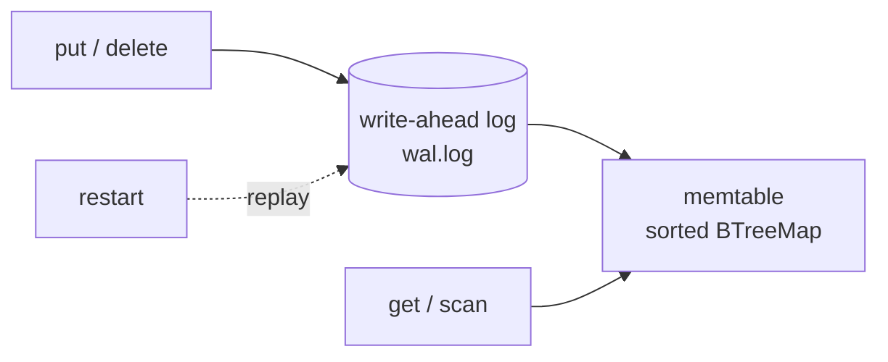

# tiny-lsm

[](https://github.com/blueRonyHazard/tiny-lsm/actions/workflows/ci.yml)

A tiny **log-structured merge-tree (LSM)** storage engine in Rust, the same
design behind RocksDB, LevelDB, Cassandra and ScyllaDB, built one milestone at
a time while I learn Rust.

It has **zero dependencies**: even the CRC-32 checksum is written by hand, so
every byte that reaches the disk can be traced through code in this repo.

```text
$ cargo run -- ./data
tiny-lsm · data in ./data · type `help`
> put language rust
ok
> put motto while(!dead) Code();
ok
> scan
language = rust
motto = while(!dead) Code();
(2 keys)
```

Kill the process at any point, start it again, and everything that printed
`ok` is still there.

## How it works (so far)



1. **Write-ahead log** ([`src/wal.rs`](src/wal.rs)). Each write is appended to
   `wal.log` as a checksummed record *before* anything else happens, and
   `fsync`ed by default.
2. **Memtable** ([`src/memtable.rs`](src/memtable.rs)). Then the write is
   applied to a sorted in-memory map. Deletes are stored as **tombstones**
   rather than removed, because later milestones will have older values on disk
   that must stay hidden.
3. **Crash recovery** ([`src/db.rs`](src/db.rs)). On open, the log is replayed
   in order to rebuild the memtable. If the last record was only half written
   (a *torn write*), its checksum fails, it is dropped, and the file is cut
   back to the last good record.

### Log record format

```text
+---------+---------+-------------+-------------+-----+-------+
| crc u32 | kind u8 | key_len u32 | val_len u32 | key | value |
+---------+---------+-------------+-------------+-----+-------+
           \______________ covered by the crc _______________/
```

## Roadmap

- [x] **1. Write-ahead log, memtable and crash recovery**
- [ ] **2. SSTables**: when the memtable passes a size limit, write it to an
      immutable sorted file with a block index; `get` searches memtable first,
      then SSTables newest to oldest
- [ ] **3. Log rotation**: start a fresh WAL after each flush and delete the old one
- [ ] **4. Merging iterator**: `scan` across the memtable and every SSTable at
      once, newest value wins, tombstones hide older values
- [ ] **5. Compaction**: merge SSTables in the background, dropping overwritten
      values and old tombstones (size-tiered first, then levelled)
- [ ] **6. Bloom filters**: skip SSTables that definitely don't hold a key
- [ ] **7. Benchmarks**: writes/sec, reads/sec and write amplification, with
      and without `fsync`
- [ ] **8. In the browser**: compile to WebAssembly and visualise flushes and
      compaction live on [my playground](https://blueronyhazard.github.io/playground/)

## Running it

```bash
cargo run -- ./data   # interactive shell
cargo test            # unit + crash-recovery tests
cargo doc --open      # browsable API docs
```

## Rust I learned along the way

A running list of language ideas each milestone forced me to understand.

| Idea | Where |
| --- | --- |
| `Result`, the `?` operator and `From` for error conversion | `error.rs` |
| Enums with data (`Entry::Tombstone`, `Record::Put { .. }`) and `match` | `memtable.rs`, `wal.rs` |
| Borrowing and lifetimes: `get` returns `&[u8]` tied to the memtable | `memtable.rs` |
| `&mut self` as a compile-time "one writer at a time" guarantee | `db.rs` |
| `const fn` tables built at compile time | `crc32.rs` |
| `checked_add` instead of trusting lengths read from disk | `wal.rs` |
| RAII cleanup with `Drop` | `tests/recovery.rs` |
| Let chains (`if let ... && ...`, 2024 edition) | `db.rs` |

## Further reading

- *Designing Data-Intensive Applications*, chapter 3 (Martin Kleppmann)
- [The Log-Structured Merge-Tree](https://www.cs.umb.edu/~poneil/lsmtree.pdf) (O'Neil et al., 1996)
- [LevelDB implementation notes](https://github.com/google/leveldb/blob/main/doc/impl.md)
- [mini-lsm](https://skyzh.github.io/mini-lsm/), a full course on building an LSM in Rust

## Licence

MIT
